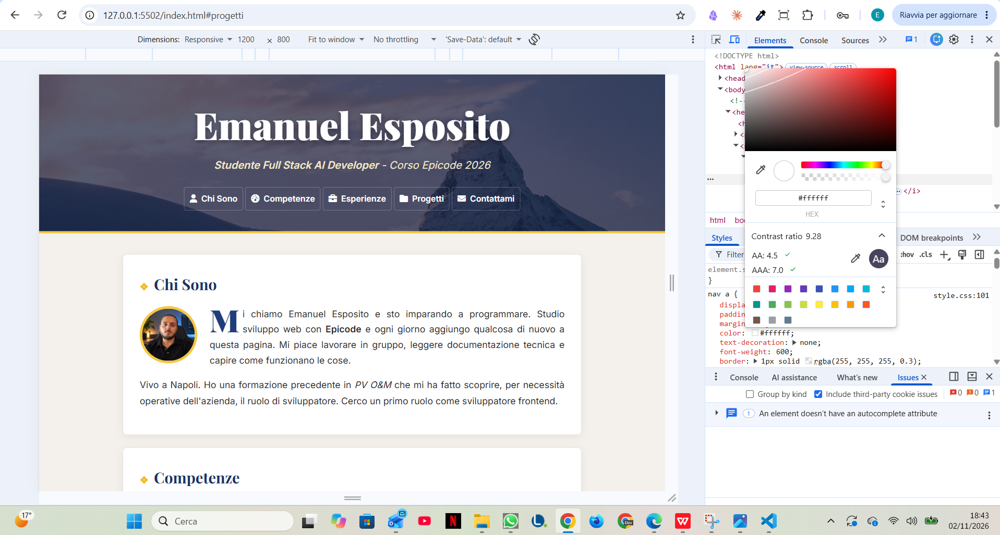

# Portfolio Personale — Responsive Refactoring

## Obiettivo
Adattamento del portfolio personale con approccio **mobile-first**, mantenendo la grafica originale.

## Modifiche effettuate
- Media query a **768px e 1200px**.
- Header, navigazione, immagini e sezioni responsive.
- Avatar centrato su mobile e affiancato al testo su desktop.
- Tabelle con scorrimento orizzontale tramite `overflow-x: auto`.
- Form e pulsante adattati alle diverse larghezze.
- Tipografia responsive con `clamp()`.

## Verifica accessibilità — WCAG
Ho verificato il contrasto tra il testo bianco della navigazione e lo sfondo dell'header utilizzando **Chrome DevTools**, campionando una delle zone più chiare dell'immagine.

- **Contrasto rilevato:** 8.09:1
- **WCAG AA (4.5:1):** Superato
- **WCAG AAA (7:1):** Superato

Il risultato riguarda il punto campionato. Un gradiente scuro contribuisce a mantenere leggibile la navigazione.

### Screenshot della verifica

## Tecnologie
HTML5 · CSS3 · Media Queries · Chrome DevTools

**EPICODE — Full Stack AI Developer 2026**