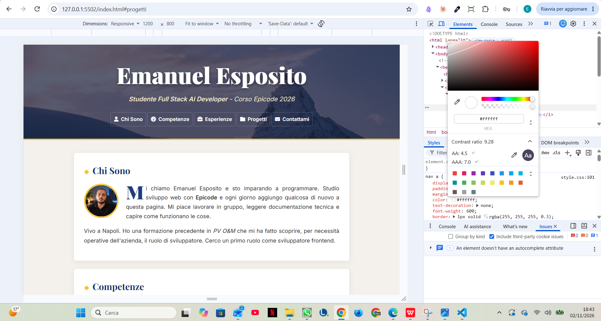

# Portfolio Personale — Responsive Refactoring

## Obiettivo
Adattamento del portfolio personale con approccio **mobile-first**, mantenendo la grafica originale.

## Modifiche effettuate
- Media query a **768px e 1200px**.
- Header, navigazione, immagini e sezioni responsive.
- Avatar centrato su mobile e affiancato al testo su desktop.
- Tabelle con scorrimento orizzontale tramite `overflow-x: auto`.
- Form e pulsante adattati alle diverse larghezze.
- Tipografia responsive con `clamp()`.

## Verifica accessibilità — WCAG
Ho verificato il contrasto tra il testo bianco della navigazione e lo sfondo dell'header utilizzando **Chrome DevTools**, campionando una delle zone più chiare dell'immagine.

- **Contrasto rilevato:** 8.09:1
- **WCAG AA (4.5:1):** Superato
- **WCAG AAA (7:1):** Superato

Il risultato riguarda il punto campionato. Un gradiente scuro contribuisce a mantenere leggibile la navigazione.

### Screenshot della verifica

## Tecnologie
HTML5 · CSS3 · Media Queries · Chrome DevTools

**EPICODE — Full Stack AI Developer 2026**

## Aggiornamento 04/11/2026 — Refactoring con Flexbox

Durante la lezione EPICODE ho migliorato il layout responsive del portfolio utilizzando Flexbox.

### Modifiche effettuate

- **Navigazione:** utilizzo di `display: flex`, `flex-wrap`, `gap` e `justify-content` per distribuire uniformemente i pulsanti.
- **Chi Sono:** sostituzione di `float` con Flexbox per affiancare avatar e testo da 768px.
- **Competenze:** creazione di chips arrotondate, con dimensioni uniformi e disposizione responsive.
- **Progetti:** realizzazione di una griglia responsive con `flex-wrap` e `flex: 1 1 300px`.
- **Footer:** riorganizzazione delle icone social e del copyright con Flexbox.
- **Form Contattami:** utilizzo di `localStorage`, `JSON.stringify()` e `JSON.parse()` per visualizzare i dati nella pagina `success.html`.

### Concetti approfonditi

- `display: flex`
- `flex-direction`
- `justify-content` e `align-items`
- `flex-wrap` e `gap`
- `flex-grow`, `flex-shrink` e `flex-basis`
- `order`
- `localStorage` e manipolazione del DOM

**Nota:** il modulo di contatto è dimostrativo. I dati vengono salvati nel browser e non inviati a un server.